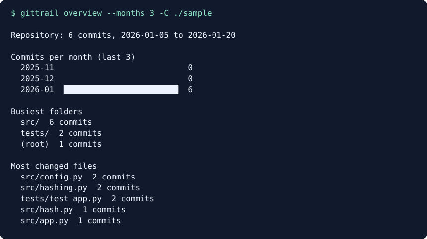

# gittrail

[](https://github.com/Ibom1/gittrail/actions/workflows/test.yml)

Read a repository's git history and explain how the code got where it is: which commits changed what, which files change most, and the full timeline of a single file, renames included. Runs locally, needs only Python and git, and never changes your repository.



Overview captured from the six-commit sample repository.

## Try it in 30 seconds

```sh
git clone https://github.com/Ibom1/gittrail.git
cd gittrail
python -m gittrail demo          # builds a sample repo, shows the output, cleans up
python -m gittrail demo --keep   # keeps the sample so you can try more commands
```

## Who it's for

Developers who join a project, come back to old code, or review a branch and want to know *how* the code got this way, not just what it looks like today. `git log` has the answers, but they're hard to read; gittrail turns them into short, plain summaries.

## What it does

| Command | What it shows |
|---|---|
| `gittrail log [rev]` | Commits newest first, with files changed and lines added / removed, then a summary and the most-changed files |
| `gittrail log --files` | The same, listing every file each commit touched (renames shown as `old -> new`) |
| `gittrail file <path>` | Every commit that touched one file, oldest first, following renames, and every name it was known by |
| `gittrail changes <from>..<to>` | Commit count and net file changes between two revisions, grouped by folder |
| `gittrail overview` | Monthly activity, busiest folders, and most changed files |
| `gittrail demo` | Run the CLI against a disposable sample repository |

The report commands accept `-C <repo>`, `--json`, `--md`, and `--no-color`. Use `NO_COLOR` to disable terminal color. On `log`, combine `-n`, `--since`, `--until`, and `-- <path>`. Use `overview --months N` to choose the monthly window.

### Exit codes

| Code | Meaning |
|---|---|
| 0 | Success |
| 2 | git failed, or the folder isn't a git repository |
| 64 | Wrong usage |

## How it compares

- **`git log`** gives you the underlying history and flexible filters. Gittrail adds a ready-to-read summary and a ranked list of changed files.
- **tig** lets you browse history interactively in a terminal. Gittrail prints a report you can read, save, or consume as JSON.
- **git-quick-stats** summarizes repository activity. Gittrail focuses on what changed in the code and follows an individual file across renames.
- Most Git statistics tools rank contributors. Gittrail reports on the code only, with no author names or rankings.

## Quick start

Requires Python 3.9+ and Git. Check with `python --version` and `git --version`. On Windows, use `py --version` and substitute `py` for `python` if needed.

```bash
git clone https://github.com/Ibom1/gittrail.git
cd gittrail
python -m gittrail log -n 5          # run without installing
pip install -e .                     # or install the `gittrail` command
gittrail file README.md
gittrail log -C ../other-repo
```

Build the sample in a folder of your choice with `python examples/make_sample_repo.py ./sample`.

## Examples

| Task | Command |
|---|---|
| See the last 10 commits | `gittrail log -n 10` |
| See changes since the last release | `gittrail changes v0.1.0..HEAD` |
| Get a repository overview | `gittrail overview` |
| See one folder's history | `gittrail log -- src/` |
| See the last two weeks | `gittrail log --since "2 weeks ago"` |
| Generate Markdown release notes | `gittrail changes v0.1.0..v0.2.0 --md` |

## Troubleshooting

| You see | Why | Fix |
|---|---|---|
| `not a git repository` (exit 2) | The selected folder is outside a Git repository | Change directories or use `-C` |
| `git is not installed or not on PATH` | Git is unavailable to the shell | Install Git and reopen the terminal |
| `gittrail: command not found` | The entry point is unavailable in this shell | Activate the install environment or run `python -m gittrail` from the checkout |
| Usage error (exit 64) | The command or options are invalid | Run `gittrail --help` or `gittrail <command> --help` |

## Built with

Python standard library only (`subprocess`, `argparse`, `dataclasses`, `json`). gittrail uses read-only Git commands and parses their output; it never writes to the repository being analyzed (see [`test_never_changes_the_repository`](tests/test_gittrail.py#L146)). Tests use `unittest` and build throwaway git repos for each case:

```bash
python -m unittest
```

## Project layout

```
gittrail/git.py      runs git log and parses its output (commits, line counts, renames)
gittrail/history.py  file timelines and log summaries
gittrail/reports.py  revision comparisons and repository overviews
gittrail/sample.py   shared sample repository builder
gittrail/cli.py      the commands and their text / JSON output
tests/               tests on throwaway repositories
```

## License

[MIT](LICENSE)
